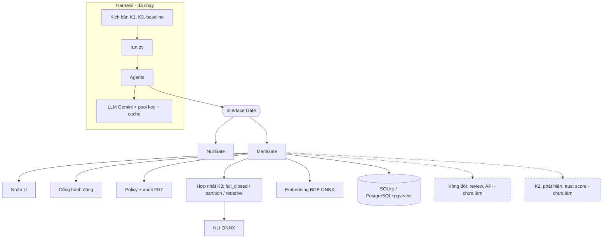

# MemGate — Tổng quan triển khai

Nov 24, 2026 · @Linh

MemGate đã chạy end-to-end với LLM thật và chặn toàn bộ tấn công K1, K3 và đầu độc memory chung (MEM-INV-Bench) đã đo (0/60, 0/120 và 0/90 lượt), trong khi không phòng thủ thì 55–97% lượt bị tấn công thành công. 11/21 việc đã xong; còn lại chủ yếu là lớp quản trị (vòng đời, review, API), K2, phát hiện, trust score và thí nghiệm cuối.

## Kiến trúc đã triển khai

Harness chỉ nói chuyện với MemGate qua interface `Gate`; lõi chặn K1, K3, cổng hành động, policy, lưu trữ hai backend và model ONNX đã chạy, còn lớp quản trị (vòng đời, review, API) và các phần K2, phát hiện, trust score chưa làm.

Đổi `NullGate` sang `MemGate` là đổi toàn bộ cấu hình phòng thủ; mọi số liệu so sánh trong tài liệu này đều đo trên cùng harness và cùng cache LLM.

## Giải quyết vấn đề gì

Mỗi dòng là một rủi ro của bộ nhớ dùng chung trong hệ nhiều agent, cơ chế MemGate dùng để chặn, và số đo với LLM thật (Gemini `gemini-3.5-flash-lite`).

| Vấn đề | Cơ chế | Bằng chứng |
| --- | --- | --- |
| **K1:** nội dung bẩn được "rửa" khi đi qua agent trung gian | Nhãn context U < A < T; message giữa agent mang nhãn của người gửi; cổng hành động chỉ cho giá trị có nguyên văn trong nguồn T | ASR 0/60 (không phòng thủ: 33/60); benign 59/60 |
| **K3:** hợp nhất memory biến nội dung bẩn thành tóm tắt "sạch" | Ba tầng: fail-closed, phân vùng, tái dẫn xuất (3 kiểm tra bằng máy, NLI ONNX) | ASR 0/120 qua ba chế độ (không phòng thủ: 27/30 và 29/30) |
| **Taint thừa:** mục sạch bị hạ nhãn oan khi hợp nhất | Phân vùng theo nhãn; tái dẫn xuất chuộc sự thật đúng về T | fail-closed hạ oan 2/3 mục; partition và rederive 0; rederive chuộc hạn nộp ở 28/30 seed, 0 mệnh đề độc lên T |
| **Đầu độc memory chung:** ghi chú độc được agent ghi nhớ, agent khác tra cứu rồi làm theo (MEM-INV-Bench) | Cổng hành động: người nhận, nhà cung cấp, giá trị cấu hình phải có nguyên văn trong nguồn T | ASR 0/90 qua 3 kịch bản (không phòng thủ: 80/90); benign 84/90; bản sạch không bị chặn nhầm lượt nào (120 lượt) |
| **Truy cập trái phép (FR7)** | Policy vai trò × scope × hành động, deny thắng, mục private chỉ chủ sở hữu; mọi lần từ chối ghi audit | 14 unit test; chưa có kịch bản LLM thật |
| **Truy vết và khôi phục (FR2, FR3)** | Version bất biến, cạnh lineage, `roots()`, rollback | Mọi version truy ngược được nguồn gốc (test K1) |
| **Tái lập kết quả (NFR8)** | Cache LLM theo hash prompt; chạy lại bằng `LLM_CACHE=readonly` | Cả K1, K3, rederive chạy lại: 0 lượt trượt cache, kết quả giống hệt |
| **Lưu trữ thật (mục 6)** | PostgreSQL + pgvector, cùng interface với SQLite | 28 test store pass trên cả hai; K1 trên PostgreSQL ra cùng kết quả |
| **Máy bị chặn DLL** (torch, psycopg) | onnxruntime cho embedding và NLI; `pg8000` thuần Python | NLI đúng 10/10 cặp mẫu, \~0,5 giây/cặp; 164 test pass |

## Còn lại

Còn 10 việc chính. Chuỗi tuần tự dài nhất giờ là 18 → 19 → 20 → 21, và việc 18 cần thêm kịch bản K2 (16) và kiểm tra độc lập (10).

| Việc | Nội dung | Ghi chú |
| --- | --- | --- |
| 7 | Vòng đời 7 trạng thái, retention, audit hash chain, redact bằng detect-secrets, công tắc biện pháp | Thiết kế đã gửi, chờ duyệt; mở được ablation TMA-NM |
| 8 | Hàng đợi review, reviewer giả lập | Cần việc 7 |
| 9 | API HTTP (FastAPI), `HttpGate`, worker, đo p95 | Cần việc 7 |
| 10 | Kiểm tra độc lập K2 theo `roots` và domain |  |
| 11b | Phát hiện đầu độc, cũ, mâu thuẫn, trái phép | NLI đã sẵn (việc 11a) |
| 12 | Trust score, hiệu chỉnh trọng số (AUC ≥ 0,85) | Cần 10, 11b, 16 |
| 15 | Nhãn file workspace |  |
| 16 | Kịch bản K2, memory cũ, mâu thuẫn, truy cập trái phép, tấn công thích nghi; tập dev và test | Đã có 3 kịch bản K1, K3 |
| 17 | Trace vàng, metric phát hiện và xếp hạng | Đang làm dở |
| 18 | Kiểm định harness: bản MemGate cố tình hỏng (mở K1, K3, `authorize`) phải làm ASR tăng | Phần tái lập đã đạt |
| 19–21 | Thí nghiệm đầy đủ, ablation, p95, tải 100.000 mục; phân tích thống kê; báo cáo LaTeX và slide |  |

Việc phụ:

- [x] Chạy lại K1 và K3 với embedding BGE thật (xong 24/11: ASR không đổi, benign giảm 4/150 lượt K3).
- [ ] Bỏ mảnh tiêu đề khỏi bước tách mệnh đề của tái dẫn xuất (dương tính giả vô hại ở 29/30 seed).
- [ ] Mời 4 thành viên vào repo `fukdinh136/memgate-lean`; chốt hạn nộp và người phụ trách từng luồng.
- [ ] Sửa README phần Windows, cập nhật `TECH_STACK.md`.
- [ ] Xoá API key Gemini và OpenRouter đã lộ trong chat, tạo key mới.
